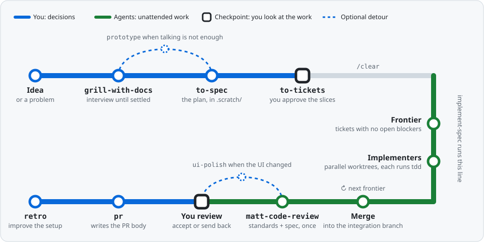
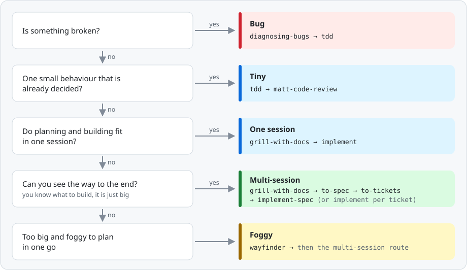
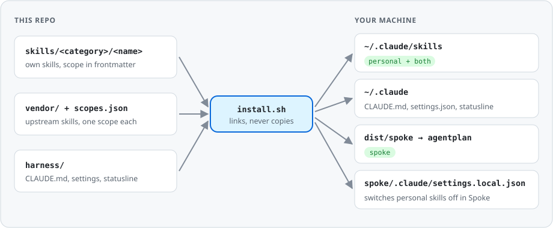

# Agent Skills

My agent harness in one repo: skills, global instructions and Claude Code settings, installed the same way on every machine with one command. The flow is built on [Matt Pocock's skills](https://github.com/mattpocock/skills), run as shipped.

<p align="center">
  
</p>

<p align="center"><a href="https://claude.ai/artifact/H61kH7FYPoeeJ6Twn9fUPR"><strong>Explore the interactive flow map</strong></a>: every station explained, with the route picker, guardrails and glossary.</p>

## In One Minute

1. **You get interviewed.** `grill-with-docs` asks questions until nothing is left to decide. Terms go to `GLOSSARY.md`, decisions to `docs/adr/`.
2. **The plan is written down.** `to-spec` turns the conversation into a spec, and `to-tickets` cuts it into thin end-to-end slices that each fit in one fresh context, with the tickets that block them.
3. **Agents build it.** After `/clear`, `implement-spec` hands every ready ticket to an agent in its own git worktree. Each one works test-first and is merged into one integration branch.
4. **The work is checked once.** `matt-code-review` reviews the whole branch against the repo's standards and the spec, and an agent fixes what it finds.
5. **You accept it and improve the setup.** You review the branch, `pr` writes the PR body, and `retro` turns rough spots into better checks, standards and pointers.

Throughout, Claude Code's deny rules block force-push, pushing to `main`, merging PRs, `rm -rf` and reading `.env` files.

## Quick Start

```bash
# dotfiles clone this repo to ~/Developer/agent-skills and run install.sh
~/Developer/dotfiles/install.sh

# or by hand
git clone git@github.com:willianjusten/agent-skills.git ~/Developer/agent-skills
~/Developer/agent-skills/install.sh
```

Then log in with `claude`. For Spoke, see [Spoke](#spoke).

## Pick a Route

Go down the questions; the first yes picks the route. Not sure? Run `/ask-matt`.

<p align="center">
  
</p>

## A Feature, Step by Step

| # | Run | You do | You get |
| - | --- | ------ | ------- |
| 1 | `/grill-with-docs` | Answer, steer, keep the scope small | A settled plan, `GLOSSARY.md`, `docs/adr/` |
| 1b | `/handoff`, `/prototype`, `/handoff` back | Only when a question needs running code to answer | The answer, back in the grilling session |
| 2 | `/to-spec` | Read the test seams and Out of Scope first | The spec in `.scratch/<feature>/` |
| 3 | `/to-tickets` | Check size and blocking edges, then `/clear` | One ticket file per slice |
| 4 | `/implement-spec <feature>` | Wait, or run `/implement` per ticket instead | An integration branch, every ticket `Status: done` |
| 5 | Review the branch | Accept it or send it back | Code you trust |
| 6 | `pr` (runs on its own) | Push when ready | The PR body |
| 7 | `/retro` | Pick which suggestions to keep | Better checks, standards and pointers |

> [!TIP]
> Keep steps 1 to 3 in one context window: the grilling is the most valuable context in the session. Clear only after the tickets exist, and run `/retro` before clearing the session it looks back on.

For a bug: `/diagnosing-bugs` reproduces it and finds the cause, then the fix goes in test-first with `tdd`.

## Skills at a Glance

| When | Skills |
| ---- | ------ |
| **Plan** | `grill-with-docs` (in a repo), `grill-me` (no repo), `prototype`, `research`, `to-spec`, `to-tickets`, `wayfinder` |
| **Build** | `implement` (one ticket), `implement-spec` (whole spec, parallel), `tdd`, `matt-code-review` |
| **Ship and learn** | `pr`, `retro` |
| **Fix and tidy** | `diagnosing-bugs`, `triage`, `improve-codebase-architecture`, `codebase-design`, `domain-modeling` |
| **Any time** | `ask-matt` (which skill?), `handoff` (pass work to a new session), `wait-what` (re-explain that), `teach`, `to-questionnaire`, `wizard`, `frontend-design`, `writing-for-agents`, `skill-creator-plus` |

Every installed skill and its scope is in [`scopes.json`](scopes.json).

### Where things land in a project

```text
.scratch/<feature>/   specs, tickets, wayfinder maps (local markdown tracker, gitignore it per repo)
GLOSSARY.md           canonical domain terms
docs/adr/             decision records
```

The global instructions point every repo at these defaults, so no per-repo setup is needed. Run `/setup-matt-pocock-skills` in a repo only to override them.

## What This Repo Adds

Matt's skills run untouched. Everything this repo layers on top lives in a few files:

| File | Read by | Holds |
| ---- | ------- | ----- |
| [`harness/shared/instructions.md`](harness/shared/instructions.md) | every session and subagent, as `~/.claude/CLAUDE.md` | Precedence, safety, style, environment, tracker defaults |
| [`harness/shared/CODING_STANDARDS.md`](harness/shared/CODING_STANDARDS.md) | sessions, as `~/.claude/CODING_STANDARDS.md` | Cross-repo coding standards; a repo's own standards win |
| [`harness/claude/settings.json`](harness/claude/settings.json) | Claude Code | Deny rules, auto mode, notification sounds, statusline |

The only patch to vendored code is renaming Matt's `code-review` to `matt-code-review`, because the original collides with Claude Code's built-in `/code-review`. New additions come only after a pilot, one ticket per `/retro` finding.

## How Install Works

<p align="center">
  
</p>

Everything `install.sh` creates is a symlink into this repo, so editing a file here changes it on the machine at once. A second run prints `No changes.`

### Scopes

Each skill has a scope that decides where it shows up:

| Scope | Shows up in |
| ----- | ----------- |
| `personal` | every repo except Spoke |
| `both` | every repo, Spoke included |
| `spoke` | Spoke only |
| `off` | nowhere (kept on record, not installed) |

Own skills declare it in frontmatter. Vendored skills get one line in [`scopes.json`](scopes.json); a vendored skill missing from it is not installed.

```yaml
metadata:
  scope: both
```

## Common Tasks

| Task | Do |
| ---- | -- |
| Create a skill | Ask "make this a skill" (runs `skill-creator-plus`), put it in `skills/<category>/<name>/` with `metadata.scope` and a README (see [AGENTS.md](AGENTS.md)), then `./install.sh check` and `./install.sh` |
| Improve a skill | Ask "audit my <name> skill", approve the fixes, `./install.sh check` |
| Change a scope | Edit the frontmatter or `scopes.json`, then `./install.sh` |
| Remove an own skill | Delete its folder, then `./install.sh` |
| Update vendored skills | `./install.sh --update`, review `git diff vendor/`, commit |
| Enable a vendored skill | Set it to `personal` or `both` in `scopes.json`, then `./install.sh --update` |
| Add a vendor source | Add `"<owner>/<repo>": { "<skill>": "personal" }` to `scopes.json`, then `./install.sh --update` |
| Override tracker setup for one repo | `/setup-matt-pocock-skills` in that repo |

## Repository Layout

```text
agent-skills/
├── skills/                         own skills: SKILL.md, README.md, references/, scripts/
│   ├── engineering/
│   ├── productivity/
│   └── product/
├── vendor/                         managed by `npx skills`, never edited by hand
│   ├── anthropics/skills/
│   ├── mattpocock/skills/
│   ├── robonuggets/skill-creator-plus/
│   └── vercel-labs/agent-browser/
├── scopes.json                     scope for each vendored skill, grouped by source
├── harness/
│   ├── shared/                     instructions.md (~/.claude/CLAUDE.md), CODING_STANDARDS.md
│   └── claude/                     settings.json, statusline-command.sh
├── docs/images/                    diagrams for this README
├── install.sh                      the only command
├── AGENTS.md                       conventions for editing this repo (CLAUDE.md imports it)
└── dist/                           generated, gitignored
```

## Reference

<details>
<summary><strong>install.sh commands</strong></summary>

| Command | Effect |
| ------- | ------ |
| `./install.sh` | Links `~/.claude/CLAUDE.md`, `CODING_STANDARDS.md`, `settings.json` and `statusline-command.sh` into `harness/`; links each `personal`/`both` skill into `~/.claude/skills/<name>`; removes links into this repo that are no longer wanted; applies the Spoke layer when `~/Developer/spoke` exists |
| `./install.sh --update` | First runs `npx skills update` per vendor source, adds enabled skills that are missing, removes ones set to `off`, lists new upstream skills as candidates |
| `./install.sh --force` | Replaces a real file that sits where a link should go |
| `./install.sh check` | Runs the `skill-creator-plus` validator on every own skill, plus scope and README checks |

Nothing else in `~/.claude` is touched: `skills/synced/` (claude.ai skills), `projects/`, plugins and history stay as they are.

Requirements: `git` and `jq`; `--update` also needs node >= 22.20; `check` needs `python3`.

Library docs come from the Context7 MCP server, installed once at user scope. It works without a key; `install.sh` warns when it is missing but does not install it:

```bash
claude mcp add --scope user --transport http context7 https://mcp.context7.com/mcp
```

For higher rate limits, add a free key from context7.com/dashboard with `--header "Authorization: Bearer <key>"`.

</details>

<details id="spoke">
<summary><strong>Spoke</strong></summary>

Spoke's own skills come from its workspace and `agentplan`; this repo adds a thin layer on top:

- `personal` skills are switched off in Spoke through `skillOverrides` in `spoke/.claude/settings.local.json` (Claude Code only).
- `spoke` skills are linked into `dist/spoke/`, which agentplan reads as a global skill source. Add it once to `spoke/agentplan.jsonc`, then `make sync` in Spoke:

```jsonc
"sources": { "skills": { "global": ["../agent-skills/dist/spoke"] } }
```

Setting up Spoke from scratch (web repos only):

```bash
mkdir -p ~/Developer/spoke && cd ~/Developer/spoke
git clone git@github.com:getcircuit/workspace.git .spoke-workspace
make -C .spoke-workspace setup ROLE=none
make repos REPOS="knowledge web-apps web-packages domain backend-services"
make -C .spoke-workspace setup ROLE=product-web-engineer
~/Developer/agent-skills/install.sh
```

</details>

<details>
<summary><strong>Troubleshooting</strong></summary>

| Symptom | Fix |
| ------- | --- |
| `Rename patch no longer matches` | Upstream changed the text. Update the pattern in `apply_renames` in `install.sh`. |
| `Unpatched code-review references` | Upstream added a new reference. Add a `patch_file` line for it. |
| `real file in the way` | Something replaced a symlink. Diff it against `harness/`, keep what you want, then `./install.sh --force`. |
| `new upstream skill ... add it to scopes.json` | Decide a scope for it in `scopes.json`, then `./install.sh --update`. |
| `skills CLI failed` | The output above it comes from `npx skills`: usually network, or a skill that no longer exists upstream. |
| `settings.json` changed after using `/config` | Claude Code writes through the symlink. Review the diff, strip machine paths, commit. |

</details>

<details>
<summary><strong>Words you'll hear</strong></summary>

| Word | Meaning |
| ---- | ------- |
| Tracer bullet | A thin slice through every layer (data, logic, UI, tests) that works end to end on its own |
| Blocking edge | "Ticket B can't start until ticket A is done" |
| Frontier | The tickets whose blockers are all done, ready to start now |
| Worktree | A separate checkout of the same repo on its own branch, so agents don't step on each other |
| Integration branch | Where every finished ticket is merged before you review the whole feature |
| Seam | The public boundary where a feature is tested, agreed in the spec, so tests survive refactors |
| Smart zone | The part of a context window where the model still reasons well; past it, quality drops |

</details>
