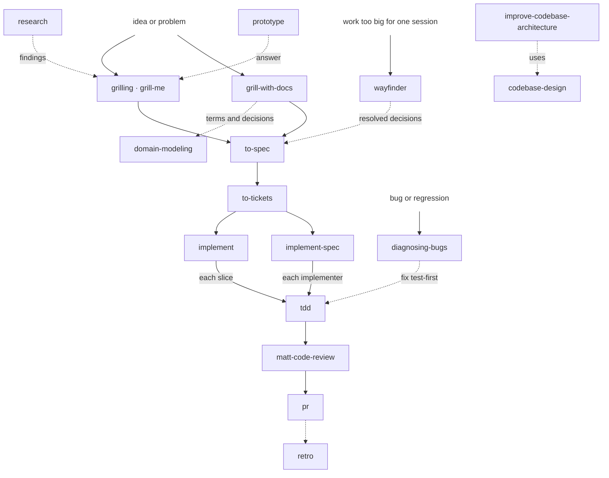
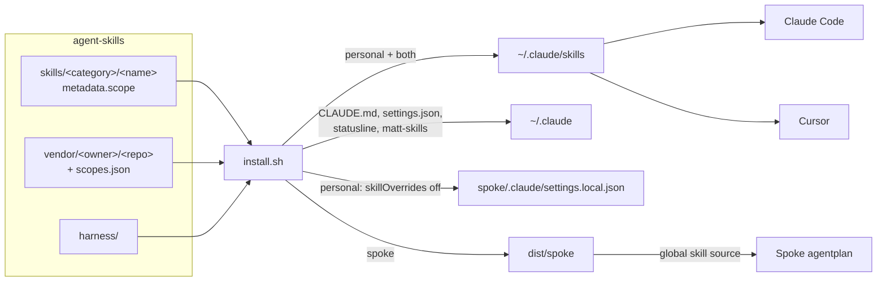

# Agent Skills

My agent harness in one repo: skills, global instructions and Claude Code settings, installed the same way on every machine with one command. Works in Claude Code and Cursor.

## What are Skills?

Skills are packaged instructions that teach an agent a workflow. A skill is a folder with a `SKILL.md`: YAML frontmatter tells the agent when to use it, the markdown body tells it what to do, and supporting files (`references/`, `scripts/`) load only when a step needs them, so idle skills cost almost no context.

They follow the [Agent Skills](https://agentskills.io) open standard, so the same folder works in Claude Code, Cursor and other agents. Some skills are **model-invoked** (the agent picks them up when a request matches the description); others are **user-invoked** only (`disable-model-invocation: true`), run by typing `/<name>`.

## Quick Start

On a new machine:

```bash
# 1. dotfiles clone this repo to ~/Developer/agent-skills and run install.sh
~/Developer/dotfiles/install.sh

# or by hand
git clone git@github.com:willianjusten/agent-skills.git ~/Developer/agent-skills
~/Developer/agent-skills/install.sh
```

Then:

1. Log in to Claude Code: `claude`.
2. Paste [`harness/shared/instructions.md`](harness/shared/instructions.md) into Cursor > Settings > Rules > User Rules.
3. For Spoke, see [Spoke](#spoke).

## Skills

**Scope** says where a skill shows up (see [Scopes](#scopes)). **Invoked** says who starts it: `model` (matched from your request) or `/name` (only when you type it).

### Engineering

| Skill | Source | Scope | Invoked | Description |
| ----- | ------ | ----- | ------- | ----------- |
| **diagnosing-bugs** | mattpocock | both | model | Diagnosis loop for hard bugs and performance regressions |
| **tdd** | mattpocock | both | model | Red-green-refactor, one vertical slice at a time |
| **matt-code-review** | mattpocock | both | model | Two-axis review of a diff: repo standards and the originating spec |
| **codebase-design** | mattpocock | both | model | Shared vocabulary for deep modules, interfaces and seams |
| **prototype** | mattpocock | both | model | Throwaway prototype to answer a design question |
| **research** | mattpocock | both | model | Primary-source research captured as a Markdown file |
| **domain-modeling** | mattpocock | both | model | Sharpen domain terms in `GLOSSARY.md` and record ADRs |
| **pr** | mattpocock | personal | model | Write a PR body |
| **wizard** | mattpocock | personal | model | Interactive bash wizard for steps only a human can do |
| **to-spec** | mattpocock | both | /name | Turn the conversation into a spec in the issue tracker |
| **to-tickets** | mattpocock | both | /name | Split a spec into tracer-bullet tickets with blocking edges |
| **implement** | mattpocock | both | /name | Build one piece of work from a spec or tickets |
| **implement-spec** | mattpocock | both | /name | Build a whole spec with subagents on an integration branch |
| **afk** | own | personal | /name | Run a spec's ticket graph unattended within the usage budget, ending in a report |
| **agent-browser** | vercel-labs | personal | model | Browser automation CLI; collects UI evidence for AFK tickets |
| **wayfinder** | mattpocock | both | /name | Plan work too big for one session as a map of decision tickets |
| **triage** | mattpocock | both | /name | Move issues and PRs through triage roles into agent-ready briefs |
| **improve-codebase-architecture** | mattpocock | both | /name | Find deepening opportunities, report them, grill the chosen one |
| **grill-with-docs** | mattpocock | both | /name | Grill a plan and write the glossary and ADRs as you go |
| **setup-matt-pocock-skills** | mattpocock | personal | /name | Per-repo override of the global issue tracker, labels and docs setup |
| **retro** | mattpocock | both | /name | Retrospective on a session, aimed at the agent's environment |

### Productivity

| Skill | Source | Scope | Invoked | Description |
| ----- | ------ | ----- | ------- | ----------- |
| **grilling** | mattpocock | both | model | Stress-test a plan, decision or idea |
| **grill-me** | mattpocock | both | /name | Relentless interview to sharpen a plan |
| **handoff** | mattpocock | both | /name | Compact the conversation into a handoff document |
| **wait-what** | mattpocock | both | /name | Re-pitch the last message when it did not land |
| **writing-for-agents** | mattpocock | personal | model | Write skills, AGENTS.md and CLAUDE.md for agents |
| **skill-creator-plus** | robonuggets | personal | model | Audit, create and improve skills against Anthropic's authoring rules |
| **ask-matt** | mattpocock | both | /name | Router: which skill or flow fits the situation |
| **teach** | mattpocock | personal | /name | Teach a new skill or concept within the workspace |
| **to-questionnaire** | mattpocock | personal | /name | Turn an open decision into a questionnaire for someone else |

### Product

No skills yet. Own skills go in `skills/product/<name>/`.

Upstream skills set to `off` (Matt's misc and in-progress skills) are listed in [`scopes.json`](scopes.json).

## How They Connect



Dotted arrows are optional handoffs. `ask-matt` routes to the right entry point when unsure. `handoff`, `wait-what`, `teach` and `to-questionnaire` run whenever their own job is needed.

### Which workflow

| Work | Flow |
| --- | --- |
| Tiny: one decided behaviour | `tdd`, then `matt-code-review` |
| One session | `grill-with-docs`, then `implement` |
| Multi-session | `grill-with-docs`, `to-spec`, `to-tickets`, then `implement` per ticket |
| Parallel graph | the same planning, then `/afk` |
| Foggy | `wayfinder`, then the multi-session flow |

### Using the flow

For a feature:

1. `grill-with-docs` (or `grilling`) -> a settled plan; terms land in `GLOSSARY.md`, decisions in `docs/adr/`.
2. `to-spec` -> the spec as an issue in `.scratch/<feature>/`.
3. `to-tickets` -> tracer-bullet tickets with blocking edges.
   Run `/clear` here, once: the tickets carry the plan, so implementation starts from a fresh context.
4. `implement` per ticket, or `implement-spec` for the whole spec -> code built through `tdd`, closed by `matt-code-review`.
5. `pr` -> the PR body.
6. `retro` -> changes to the environment (checks, standards, pointers) after a rough build.

For a bug: `diagnosing-bugs` -> reproduce and find the cause -> fix test-first with `tdd`.

### Output structure

```text
.scratch/<feature>/   to-spec, to-tickets, triage, wayfinder: local markdown issue tracker (gitignore it per repo)
GLOSSARY.md           domain-modeling, grill-with-docs: canonical domain terms
docs/adr/             domain-modeling, grill-with-docs: decision records
```

Global defaults for these locations live in [`harness/claude/matt-skills/`](harness/claude/matt-skills), so no per-repo setup is needed.

## How It Works



Everything `install.sh` creates is a symlink into this repo, so editing a file here changes it on the machine at once. Cursor reads `~/.claude/skills` as a compatibility source, so it needs no extra install.

### Scopes

| Scope | Shows up in |
| ----- | ----------- |
| `personal` | every repo except Spoke |
| `both` | every repo, Spoke included |
| `spoke` | Spoke only |
| `off` | nowhere (kept on record, not installed) |

Own skills declare the scope in frontmatter; vendored skills get one line in [`scopes.json`](scopes.json), grouped by source. A vendored skill missing from `scopes.json` is not installed.

```yaml
metadata:
  scope: both
```

## Repository Layout

```text
agent-skills/
├── skills/
│   ├── engineering/<name>/         own skills: SKILL.md, README.md, references/, scripts/
│   ├── productivity/<name>/
│   └── product/<name>/
├── vendor/
│   ├── mattpocock/skills/          managed by `npx skills`: .agents/skills/ + skills-lock.json
│   ├── robonuggets/skill-creator-plus/
│   └── vercel-labs/agent-browser/
├── scopes.json                     scope for each vendored skill, grouped by source
├── harness/
│   ├── shared/instructions.md      ~/.claude/CLAUDE.md and Cursor User Rules
│   └── claude/                     settings.json, statusline-command.sh, matt-skills/, hooks/, agents/
├── install.sh                      the only command
├── AGENTS.md                       conventions for editing this repo (CLAUDE.md imports it)
└── dist/                           generated, gitignored
```

## Common Tasks

| Task | Do |
| ---- | -- |
| Create a skill | Ask "make this a skill" so `skill-creator-plus` runs NEW mode; put it in `skills/<category>/<name>/` with `metadata.scope` and a README (see [AGENTS.md](AGENTS.md)); `./install.sh check`; `./install.sh` |
| Improve a skill | Ask "audit my <name> skill"; approve the fixes; `./install.sh check` |
| Change a scope | Edit the frontmatter or `scopes.json`; `./install.sh` |
| Remove an own skill | Delete its folder; `./install.sh` |
| Update vendored skills | `./install.sh --update`; review `git diff vendor/`; commit |
| Enable a vendored skill | Set it to `personal` or `both` in `scopes.json`; `./install.sh --update` |
| Add a vendor source | Add `"<owner>/<repo>": { "<skill>": "personal" }` to `scopes.json`; `./install.sh --update` |
| Share project instructions | `./install.sh init-project <dir>`: `AGENTS.md` plus a `CLAUDE.md` with `@AGENTS.md` |

## What install.sh Touches

| Command | Effect |
| ------- | ------ |
| `./install.sh` | Links `~/.claude/CLAUDE.md`, `CODING_STANDARDS.md`, `settings.json`, `statusline-command.sh`, `matt-skills/`, `hooks/`, `agents/` into `harness/`; links each `personal`/`both` skill into `~/.claude/skills/<name>`; removes links into this repo that are no longer wanted; applies the Spoke layer when `~/Developer/spoke` exists |
| `./install.sh --update` | First runs `npx skills update` per vendor source, adds enabled skills that are missing, removes ones set to `off`, lists new upstream skills as candidates |
| `./install.sh --force` | Replaces a real file that sits where a link should go |
| `./install.sh check` | Runs the `skill-creator-plus` validator on every own skill, plus scope and README checks |

On every run it also renames Matt's `code-review` to `matt-code-review`, since the original name collides with Claude Code's built-in `/code-review`. Nothing else in `~/.claude` is touched: `skills/synced/` (claude.ai skills), `projects/`, plugins and history stay as they are. A second run prints `No changes.`

Requirements: `git` and `jq`; `--update` also needs node >= 22.20; `check` needs `python3`. The `agent-browser` skill needs its CLI: `npm i -g agent-browser@0.39.1 && agent-browser install`.

## Spoke

Spoke's own skills come from its workspace and `agentplan`; this repo adds a thin layer on top:

- `personal` skills are switched off in Spoke through `skillOverrides` in `spoke/.claude/settings.local.json` (Claude Code only).
- `spoke` skills are linked into `dist/spoke/`, which agentplan reads as a global skill source. Add it once to `spoke/agentplan.jsonc`, then `make sync` in Spoke:

```jsonc
"sources": { "skills": { "global": ["../agent-skills/dist/spoke"] } }
```

Setting up Spoke from scratch (web repos only):

```bash
mkdir -p ~/Developer/spoke && cd ~/Developer/spoke
git clone git@github.com:getcircuit/workspace.git .spoke-workspace
make -C .spoke-workspace setup ROLE=none
make repos REPOS="knowledge web-apps web-packages domain backend-services"
make -C .spoke-workspace setup ROLE=product-web-engineer
~/Developer/agent-skills/install.sh
```

## Cursor

- User Rules are a copy of `harness/shared/instructions.md`. Paste it again after editing that file.
- Skills come from `~/.claude/skills`. Keep `~/.agents/skills` and `~/.cursor/skills` empty, or skills show up twice.
- Cursor ignores `skillOverrides`, so `personal` skills also appear in Spoke there.

## Manual Cases

| Symptom | Fix |
| ------- | --- |
| `Rename patch no longer matches` | Upstream changed the text. Update the pattern in `apply_renames` in `install.sh`. |
| `Unpatched code-review references` | Upstream added a new reference. Add a `patch_file` line for it. |
| `real file in the way` | Something replaced a symlink. Diff it against `harness/`, keep what you want, then `./install.sh --force`. |
| `new upstream skill ... add it to scopes.json` | Decide a scope for it in `scopes.json`, then `./install.sh --update`. |
| `skills CLI failed` | The output above it comes from `npx skills`: usually network, or a skill that no longer exists upstream. |
| `settings.json` changed after using `/config` | Claude Code writes through the symlink. Review the diff, strip machine paths, commit. |
| A skill appears twice in Cursor | Empty `~/.agents/skills` and `~/.cursor/skills`. |
