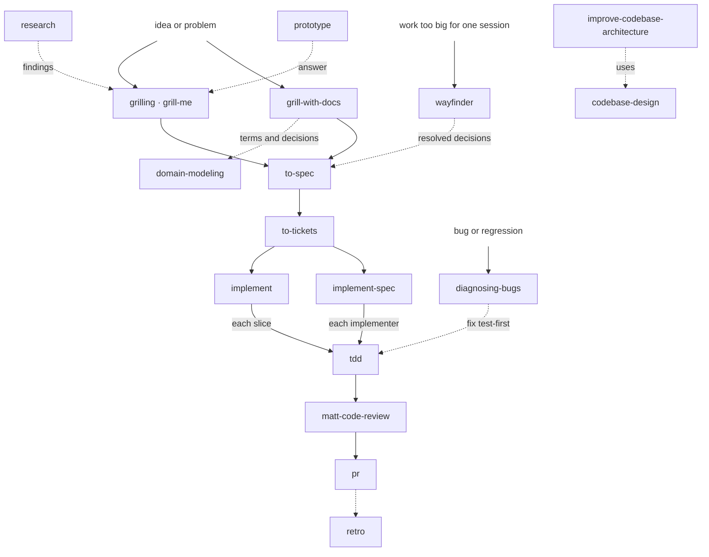
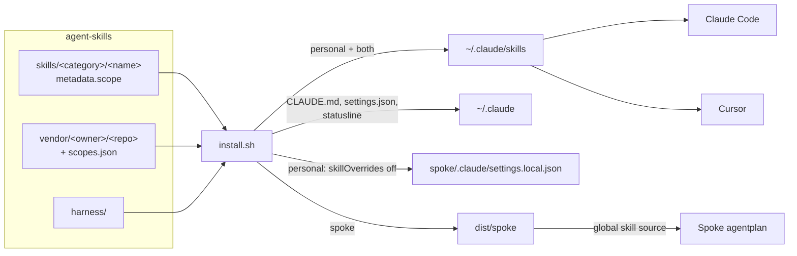

# Agent Skills

My agent harness in one repo: skills, global instructions and Claude Code settings, installed the same way on every machine with one command. Works in Claude Code and Cursor.

## Quick Start

On a new machine:

```bash
# 1. dotfiles clone this repo to ~/Developer/agent-skills and run install.sh
~/Developer/dotfiles/install.sh

# or by hand
git clone git@github.com:willianjusten/agent-skills.git ~/Developer/agent-skills
~/Developer/agent-skills/install.sh
```

Then:

1. Log in to Claude Code: `claude`.
2. Paste [`harness/shared/instructions.md`](harness/shared/instructions.md) into Cursor > Settings > Rules > User Rules.
3. For Spoke, see [Spoke](#spoke).

## The Flow



Dotted arrows are optional handoffs. `ask-matt` routes to the right entry point when unsure. Outside the flow, `handoff`, `wait-what`, `teach`, `to-questionnaire`, `triage`, `wizard`, `frontend-design`, `writing-for-agents` and `skill-creator-plus` run whenever their own job is needed. Every installed skill and its scope is in [`scopes.json`](scopes.json).

### Which workflow

| Work | Flow |
| --- | --- |
| Tiny: one decided behaviour | `tdd`, then `matt-code-review` |
| One session | `grill-with-docs`, then `implement` |
| Multi-session | `grill-with-docs`, `to-spec`, `to-tickets`, then `implement` per ticket |
| Parallel graph | the same planning, then `/implement-spec <feature>` |
| Foggy | `wayfinder`, then the multi-session flow |

### Using the flow

For a feature:

1. `grill-with-docs` (or `grilling`) -> a settled plan; terms land in `GLOSSARY.md`, decisions in `docs/adr/`.
2. `to-spec` -> the spec as an issue in `.scratch/<feature>/`.
3. `to-tickets` -> tracer-bullet tickets with blocking edges.
   Run `/clear` here, once: the tickets carry the plan, so implementation starts from a fresh context.
4. `implement` per ticket, or `implement-spec` for the whole spec -> code built through `tdd`, closed by `matt-code-review`.
5. `pr` -> the PR body.
6. `retro` -> changes to the environment (checks, standards, pointers) after a rough build.

For a bug: `diagnosing-bugs` -> reproduce and find the cause -> fix test-first with `tdd`.

### Output structure

```text
.scratch/<feature>/   to-spec, to-tickets, triage, wayfinder: local markdown issue tracker (gitignore it per repo)
GLOSSARY.md           domain-modeling, grill-with-docs: canonical domain terms
docs/adr/             domain-modeling, grill-with-docs: decision records
```

Global instructions point every repo at Matt's local-markdown defaults in `setup-matt-pocock-skills`, so no per-repo setup is needed.

## Our Layer

Matt's skills run as shipped. Everything this repo adds to his flow lives in two files:

| Extension point | Read by | Holds |
| --- | --- | --- |
| [`harness/shared/instructions.md`](harness/shared/instructions.md) | every Claude Code session and subagent (as `~/.claude/CLAUDE.md`), Cursor User Rules | Precedence, safety, style, environment, pointers to Matt's tracker docs |
| [`harness/claude/settings.json`](harness/claude/settings.json) | Claude Code | Deny rules, auto mode push policy, notification sounds, statusline |

The tracker docs are Matt's own (`issue-tracker-local.md`, `triage-labels.md`, `domain.md` in `setup-matt-pocock-skills`); the global instructions only add that work closes by setting `Status: done`. Vendor stays untouched: the `code-review` rename in `install.sh` is the only patch.

Enhancements come only after the pilot, one ticket per `/retro` finding.

## How It Works



Everything `install.sh` creates is a symlink into this repo, so editing a file here changes it on the machine at once. Cursor reads `~/.claude/skills` as a compatibility source, so it needs no extra install.

### Scopes

| Scope | Shows up in |
| ----- | ----------- |
| `personal` | every repo except Spoke |
| `both` | every repo, Spoke included |
| `spoke` | Spoke only |
| `off` | nowhere (kept on record, not installed) |

Own skills declare the scope in frontmatter; vendored skills get one line in [`scopes.json`](scopes.json), grouped by source. A vendored skill missing from `scopes.json` is not installed; upstream skills set to `off` stay listed there.

```yaml
metadata:
  scope: both
```

## Repository Layout

```text
agent-skills/
├── skills/
│   ├── engineering/<name>/         own skills: SKILL.md, README.md, references/, scripts/
│   ├── productivity/<name>/
│   └── product/<name>/
├── vendor/
│   ├── anthropics/skills/
│   ├── mattpocock/skills/          managed by `npx skills`: .agents/skills/ + skills-lock.json
│   ├── robonuggets/skill-creator-plus/
│   └── vercel-labs/agent-browser/
├── scopes.json                     scope for each vendored skill, grouped by source
├── harness/
│   ├── shared/instructions.md      ~/.claude/CLAUDE.md and Cursor User Rules
│   └── claude/                     settings.json, statusline-command.sh
├── install.sh                      the only command
├── AGENTS.md                       conventions for editing this repo (CLAUDE.md imports it)
└── dist/                           generated, gitignored
```

## Common Tasks

| Task | Do |
| ---- | -- |
| Create a skill | Ask "make this a skill" so `skill-creator-plus` runs NEW mode; put it in `skills/<category>/<name>/` with `metadata.scope` and a README (see [AGENTS.md](AGENTS.md)); `./install.sh check`; `./install.sh` |
| Improve a skill | Ask "audit my <name> skill"; approve the fixes; `./install.sh check` |
| Change a scope | Edit the frontmatter or `scopes.json`; `./install.sh` |
| Remove an own skill | Delete its folder; `./install.sh` |
| Update vendored skills | `./install.sh --update`; review `git diff vendor/`; commit |
| Enable a vendored skill | Set it to `personal` or `both` in `scopes.json`; `./install.sh --update` |
| Add a vendor source | Add `"<owner>/<repo>": { "<skill>": "personal" }` to `scopes.json`; `./install.sh --update` |
| Override the global tracker setup for a repo | `/setup-matt-pocock-skills` in the repo |

## What install.sh Touches

| Command | Effect |
| ------- | ------ |
| `./install.sh` | Links `~/.claude/CLAUDE.md`, `CODING_STANDARDS.md`, `settings.json`, `statusline-command.sh` into `harness/`; links each `personal`/`both` skill into `~/.claude/skills/<name>`; removes links into this repo that are no longer wanted; applies the Spoke layer when `~/Developer/spoke` exists |
| `./install.sh --update` | First runs `npx skills update` per vendor source, adds enabled skills that are missing, removes ones set to `off`, lists new upstream skills as candidates |
| `./install.sh --force` | Replaces a real file that sits where a link should go |
| `./install.sh check` | Runs the `skill-creator-plus` validator on every own skill, plus scope and README checks |

On every run it also renames Matt's `code-review` to `matt-code-review`, since the original name collides with Claude Code's built-in `/code-review`. Nothing else in `~/.claude` is touched: `skills/synced/` (claude.ai skills), `projects/`, plugins and history stay as they are. A second run prints `No changes.`

Requirements: `git` and `jq`; `--update` also needs node >= 22.20; `check` needs `python3`.

Library docs come from the Context7 MCP server, installed once at user scope. It works without a key; `install.sh` warns when it is missing but does not install it:

```bash
claude mcp add --scope user --transport http context7 https://mcp.context7.com/mcp
```

For higher rate limits, add a free key from context7.com/dashboard with `--header "Authorization: Bearer <key>"`.

## Spoke

Spoke's own skills come from its workspace and `agentplan`; this repo adds a thin layer on top:

- `personal` skills are switched off in Spoke through `skillOverrides` in `spoke/.claude/settings.local.json` (Claude Code only).
- `spoke` skills are linked into `dist/spoke/`, which agentplan reads as a global skill source. Add it once to `spoke/agentplan.jsonc`, then `make sync` in Spoke:

```jsonc
"sources": { "skills": { "global": ["../agent-skills/dist/spoke"] } }
```

Setting up Spoke from scratch (web repos only):

```bash
mkdir -p ~/Developer/spoke && cd ~/Developer/spoke
git clone git@github.com:getcircuit/workspace.git .spoke-workspace
make -C .spoke-workspace setup ROLE=none
make repos REPOS="knowledge web-apps web-packages domain backend-services"
make -C .spoke-workspace setup ROLE=product-web-engineer
~/Developer/agent-skills/install.sh
```

## Cursor

- User Rules are a copy of `harness/shared/instructions.md`. Paste it again after editing that file.
- Skills come from `~/.claude/skills`. Keep `~/.agents/skills` and `~/.cursor/skills` empty, or skills show up twice.
- Cursor ignores `skillOverrides`, so `personal` skills also appear in Spoke there.

## Manual Cases

| Symptom | Fix |
| ------- | --- |
| `Rename patch no longer matches` | Upstream changed the text. Update the pattern in `apply_renames` in `install.sh`. |
| `Unpatched code-review references` | Upstream added a new reference. Add a `patch_file` line for it. |
| `real file in the way` | Something replaced a symlink. Diff it against `harness/`, keep what you want, then `./install.sh --force`. |
| `new upstream skill ... add it to scopes.json` | Decide a scope for it in `scopes.json`, then `./install.sh --update`. |
| `skills CLI failed` | The output above it comes from `npx skills`: usually network, or a skill that no longer exists upstream. |
| `settings.json` changed after using `/config` | Claude Code writes through the symlink. Review the diff, strip machine paths, commit. |
| A skill appears twice in Cursor | Empty `~/.agents/skills` and `~/.cursor/skills`. |
