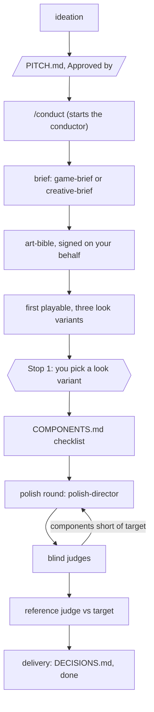

# How the creative flow works

From a spark of an idea to a judged build, with Will approving only taste. Everything after the approved pitch runs on its own and stops only at a stop point.



## The phases

| Phase | Who runs it | Output |
| ----- | ----------- | ------ |
| Ideation | `ideation` skill, with you | `PITCH.md` with an `Approved by` line |
| Start | `/conduct <pitch or app folder>` | the conductor in the background |
| Brief | conductor, via `game-brief` (game) or `creative-brief` (experiment) | `GDD.md` or `TREATMENT.md`, "Not this" list |
| Art bible | conductor, via `art-bible` | palette and asset levels (`placeholder` or `free`; `premium` stays locked) |
| Look | conductor builds the first playable with `three-build` and `three-verify`, writes three look presets and captures them with `verify --variants` | stop 1: answer with one line naming a variant (`look=auto` picks and logs it); the chosen look is recorded, never a judge benchmark |
| Target | only when the pitch asks for a target: `target-loop` | captures and a prepared target; a second stop |
| Checklist | conductor | `COMPONENTS.md`: target, folder and judge lens per component |
| Polish rounds | `polish-director` per round | workers change components in worktrees, `pnpm verify <app> --layer-cost`, blind judges, review packet |
| Reference judge | conductor, `realtime-judge` | 12 trials against the target; 7 or fewer correct passes |
| Delivery | conductor | `pnpm check`, `pnpm verify`, `DECISIONS.md`, `done` in `RUN.md` |

## Leaf versus orchestrator

A **leaf** skill works alone and names no sibling (`three-verify`, `art-bible`, `target-loop`). An **orchestrator** is an agent in `agents/` or a skill in `skills/orchestration/` and may name and run others. `./install.sh check` fails when an orchestrator names a skill or agent that is missing or scoped where it cannot see it. Why: [ADR 0001](adr/0001-leaf-and-orchestrator-skills.md).

## Nesting depth

```text
main thread (/conduct, returns at once)
  conductor                  level 1, background
    polish-director          level 2
      polish-worker, visual-judge, feel-judge, motion-judge, merger   level 3
```

Three levels is the limit. A level-3 agent never spawns. The conductor runs the reference judges itself (level 2). A director run directly from the main thread has the same workers and judges one level shallower.

## Stop points, budgets, RUN.md

The conductor never asks a question mid-run. Every call it makes instead is logged as an `assumption`. It stops, notifies you and ends at:

- a look variant chosen (skipped with `look=auto`)
- target frames chosen (only when the pitch asks for a target)
- the end of every polish round, in `mode=review` (the default; `mode=overnight` runs on, with no accept cap, until the hours are spent)
- polish plateau (judges flat two rounds, or every component at target)
- a judge split on a taste call
- a gate still failing after two fix attempts
- a spent budget: 6 polish rounds or 6 hours of active run time, where waiting for an answer is free; override with `rounds=N hours=H` on `/conduct`
- any stop the brief adds

To answer a stop, append `- <UTC timestamp> | answer | <text>` to the app's `RUN.md` and run `/conduct <app>` again.

`RUN.md` lives in the app folder, is committed and append-only. Each line is `- <UTC timestamp> | <kind> | <text>`; kinds are `start`, `step`, `phase`, `assumption`, `judge`, `revert`, `round-start`, `round`, `stop`, `answer`, `resume`, `wip`, `budget`, `accept`, `note` and `done` (the full list is in the conductor's `references/run-md.md`). `run_state.py` (in `skills/orchestration/conduct/scripts/`) reads it:

```bash
python3 -I skills/orchestration/conduct/scripts/run_state.py next <app>/RUN.md     # start, done, waiting, resume, read result, redo or continue (exits 2 on a missing file)
python3 -I skills/orchestration/conduct/scripts/run_state.py budget <app>/RUN.md   # ok, or stop: ... with exit 3
python3 -I skills/orchestration/conduct/scripts/run_state.py lock status <app>/RUN.md
```

**The lock.** One conductor per app: it takes `RUN.md.lock` first (`lock acquire --owner <id>`), refreshes it at each phase end and releases it before writing `stop` or `done`. A second start gets exit 4 and ends. A lock unrefreshed for 2 hours is stale and can be taken over. The lock is never committed.

## What never happens

Nobody but you approves a target, loosens a gate, edits `assets.manifest.json` or `targets/`, merges into the default branch or pushes. Judges are advisory; `verify` gates are the hard checks. Run limits and permissions options: see `.scratch/lab-platform/conductor-launch-options.md` (local notes, not committed).
