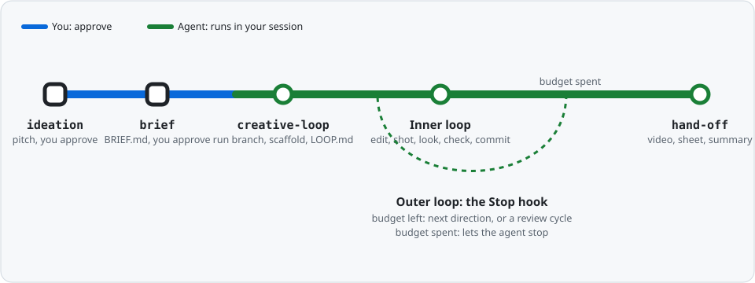
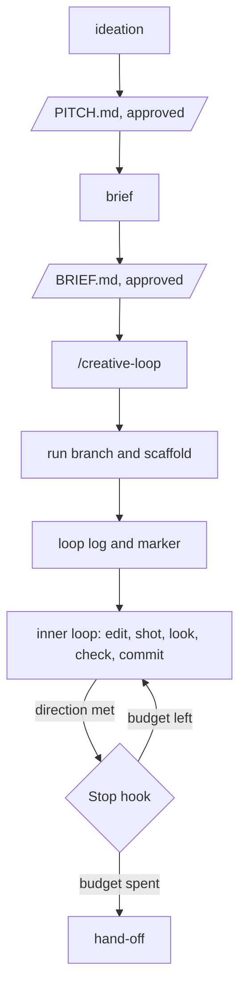

# How the creative flow works

From a spark of an idea to a delivered build. One agent works in your own session, so every step shows in the terminal. You approve the pitch and the brief; after that the loop runs until its directions and reviews run dry, or its budget is spent.

<p align="center">
  
</p>



## The steps

| Step | Who runs it | Output |
| ---- | ----------- | ------ |
| Ideation | the `ideation` skill, with you | `PITCH.md` with your `Approved by` line |
| Brief | the `brief` skill, with you | `BRIEF.md`: promise, pillars, Not this, features with checks, demo mode, Next directions |
| Scaffold | `/creative-loop` | a run branch and worktree, an app from `pnpm create-app` |
| Inner loop | the agent | one commit and one `## Cycles` line per green direction |
| Outer loop | the Stop hook | the next direction, or a review cycle, each time the agent tries to stop early |
| Overnight | the same loop, `--mode overnight` | a larger budget and no merge, push or deploy |
| Attempts | `--attempts 2` or `3` | parallel builds of one brief and a stacked video to pick from |
| Delivery | the agent | `pnpm check`, `pnpm record`, `pnpm verify`, `summary.md` |
| Hand-off | the agent | video, contact sheet and summary on your phone; the branch waits |

## 1. Ideation

```text
/ideation a small arena game where you orbit a planet
```

The skill interviews you in numbered rounds, each with a recommended answer, and writes `PITCH.md`. Nothing is built until you approve it; only your own approval fills the `Approved by` line. You can skip this step by passing a `PITCH.md` or `BRIEF.md` path to `/creative-loop`.

## 2. Brief

The `brief` skill turns the pitch into a one-page `BRIEF.md` and shows you the promise, the Not this list, the cut list and the feature list for approval. Every feature has a check a script or a screenshot can confirm. The brief ends with a numbered Next directions list, most valuable first; the loop reads it line by line.

## 3. Scaffold

```text
/creative-loop PITCH.md --budget 45m --mode review
```

Arguments: `<pitch, brief path or idea> [--budget 45m | 8h | 20cycles] [--mode review|overnight] [--attempts 1..3] [--lab <path>] [--app <name>]`. An argument or answer that is missing gets a default, logged as `Default: ...` under `## Notes`: mode `review`, 45 minutes (review) or 8 hours (overnight), the lab next to the current folder, an app name taken from the pitch.

The skill never works on the default branch. It runs `git worktree add -b loop/<app> <lab-parent>/<lab-dirname>-<app> HEAD` from the lab, `pnpm install --frozen-lockfile --offline`, then `pnpm create-app game|experiment <app>`, copies the brief to `apps/<app>/BRIEF.md` and commits the scaffold. `pnpm check <app>` must pass on the untouched template.

`scripts/start-run.sh --app-dir <worktree>/apps/<app> --budget <budget> --mode <mode> --title <title>` then fills `LOOP.md` (header and directions from the brief), writes `.loop-active` in the folder the session started in and ignores `.loop-active*` in git. Format of the log: [loop-log.md](../skills/orchestration/creative-loop/references/loop-log.md).

## 4. Inner loop

For each direction, in order:

1. Read the unchecked `## Notes` lines (this is where you steer), re-read the brief's pillars and Not this list, and add a Notes line: `On track`, `Drifted: ...` or `Brief is wrong: ...`.
2. Edit, then `pnpm shot <app> <seconds...>` and read the images. A change you have not looked at is not done.
3. `pnpm check <app>` and fix every FAIL.
4. When it is green, commit on the run branch and add one line under `## Cycles`:
   `- <n> <UTC time> <what changed>; check <PASS|FAIL counts>; <minutes used>`.

A direction that adds a gameplay event gets a sound and feedback the `game-feel` way. Two failed tries at one problem: log it under `## Open items`, cut the feature and move on. If a later try is worse than an earlier one, revert: keep the best version, not the latest.

No model judges taste. The guardrails are scripts that pass or fail; you judge the look from the video.

## 5. Outer loop

The Stop hook `harness/claude/hooks/loop-stop.sh` reads `.loop-active`, finds the log and, each time the agent tries to stop before the budget is spent, blocks with the next unchecked direction. When the list is done it asks for a review cycle: fresh shots, the three weakest things a player would notice, fix them. The list, not the clock, decides the end: each review also lists new ideas, which become new directions. A review that finds nothing and no idea worth doing is a dry review; after two in a row with every direction checked the agent sets `Status: done` and the hook lets it stop. The budget is a ceiling, and `Status: stopped` is your early exit.

Claude Code ends a session after 8 consecutive blocked stops with no tool call in between, so every block is answered with tool calls, never prose only. The hook drives only the session `/creative-loop` runs in.

## 6. Overnight

```text
/creative-loop BRIEF.md --mode overnight --budget 8h
```

The same loop with a larger budget. Rules: never merge, push, deploy, delete a branch or tag, or force anything; spend no money (free, permissively licensed packages only); never read or print `.env*` files; a blocker that survives two tries is an open item, not a night of retries. Nobody answers, so every question gets a default logged as a Notes line. The result waits on the run branch for your review.

## 7. Attempts

```text
/creative-loop BRIEF.md --attempts 3 --budget 45m
```

Two or three independent builds of the same brief. `scripts/plan-attempts.sh --lab <lab> --app <app> --attempts <n>` prints one line per attempt with its branch `loop/<app>-<run-id>-<letter>` and worktree. Each attempt is a background subagent in its own worktree with its own `LOOP.md` (`start-run.sh ... --attempts <n> --no-marker`, because the Stop hook does not drive subagents). Your session is the outer loop for each: when an attempt reports early, it sends the next direction from that attempt's log until its budget is spent.

When all are done, `pnpm record <path-a> <path-b> [<path-c>]` writes one stacked video. In review mode you pick in the conversation; in overnight mode the pick waits for morning. The agent never picks for you, never merges and never deletes the other worktrees or branches. After the pick the run continues in that attempt alone, with the hook driving as in a single run.

## 8. Delivery and hand-off

Once the hook lets the agent stop, it follows `references/hand-off.md` of the skill:

1. Set `Status: done` in the log; delete `.loop-active` and `.loop-active.state`.
2. From the run worktree: `pnpm check <app>`, `pnpm record <app>`, then `pnpm verify <app>`. A failing gate is fixed or listed as an open item; a threshold is never edited to pass.
3. Write `apps/<app>/.verify/<app>/summary.md` (at most 25 lines): branch, changes, open items, check results, defaults taken.
4. Send `play.mp4`, `play-contact-sheet.png` and `summary.md` with SendUserFile, then one PushNotification with the verdict.
5. Stop. Nothing is merged, pushed or deployed; the branch waits for you.

## Naming siblings

Any skill may name a sibling it lists in `metadata.uses`; `creative-loop` lists `ideation brief three-build game-feel game-design ui-polish`, and `brief`, `three-build` and `game-feel` list `game-design`. An **orchestrator** is a skill in `skills/orchestration/` (or an agent in `agents/`) whose main job is running others. `./install.sh check` fails when a skill names a sibling in backticks without listing it, or lists one that is missing or scoped where it cannot see it. Why: [ADR 0003](adr/0003-skills-name-siblings-through-uses.md). Why the loop is thin: [ADR 0002](adr/0002-thin-loop.md).
