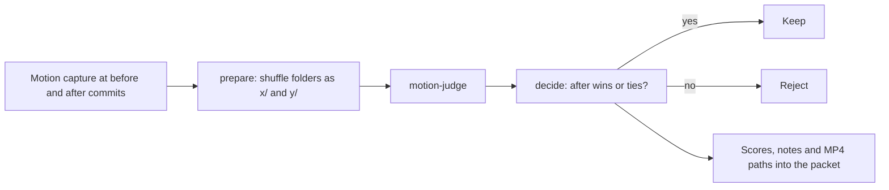

# Motion Review

A blind motion judge for polish rounds, fed frame strips, 1:1 crops and a burst instead of one still.

## What It Does



## Usage

```text
Judge the dust change in motion, blind
The stills look fine but does the grain shimmer? Score before and after
Add a motion judge to this polish round
```

## Output

- A judge directory with `x/` and `y/` only, each holding `strip.png`, `crops.png` and `burst.png`.
- A mapping file kept out of the judge's reach, and a markdown block for the packet with both scores and the decision.

## Requirements

- Python 3.
- A motion capture that writes the three sheets; in the lab, `pnpm verify <app> --motion` (needs `ffmpeg` for the MP4).
- The `motion-judge` agent.

## FAQ

- Why not a video? Judges read images; the MP4 is for the person reviewing.
- How does it combine with still judges? The motion window is one more moment; a loss there rejects the change.
