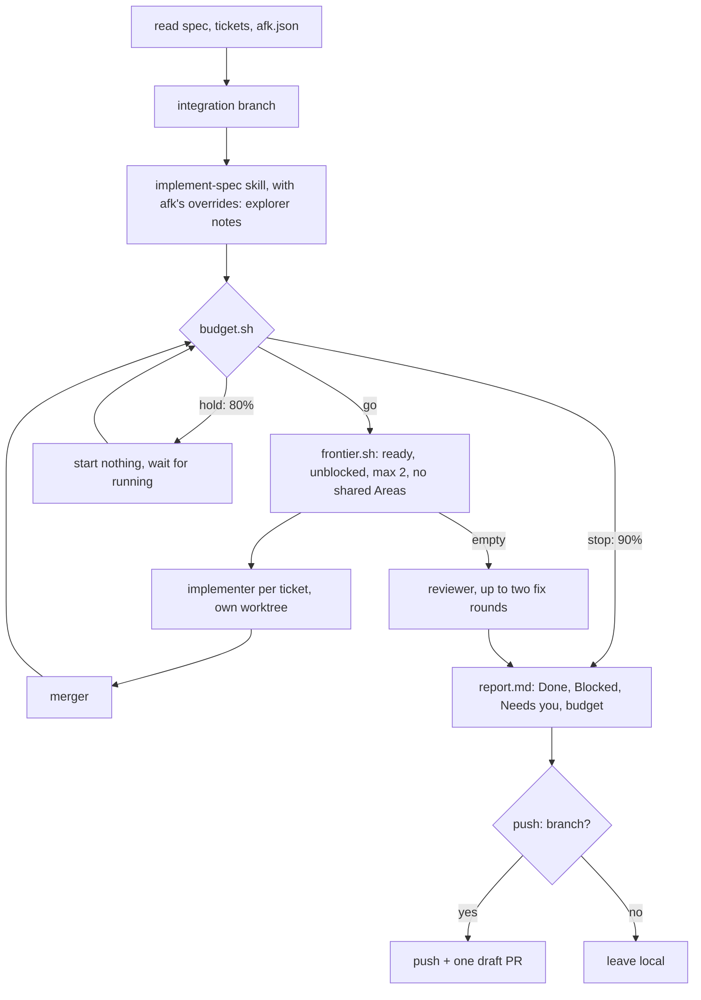

# afk

Run a spec's ticket graph unattended and come back to a report.

## What It Does



## Usage

```text
/afk .scratch/checkout-flow
/afk .scratch/harness-upgrade
```

## Output

- `<feature folder>/report.md`: Done (tickets and SHAs), Blocked, Needs you, budget used.
- `<feature folder>/review/fix-<N>.md`: one ticket per review fix round.
- Branches `afk/<feature>-<NN>` and worktrees under `<repo parent>/<repo>-afk/<feature>/`; merged ones are removed at the end.

## Requirements

- Sibling skills and agents it calls by name: `implement-spec` (its SKILL.md is read and followed with afk's overrides, since it is not model-invocable), the `explorer`, `implementer`, `merger` and `reviewer` subagents, and `tdd` (through the implementer).
- `jq` and `git`; `gh` only with `"push": "branch"`.
- The statusline usage cache at `~/.cache/claude-statusline/usage-api.json` for the budget guard. Without it the run carries on, capped only by the 2-implementer limit and the two fix rounds.
- Tickets in the local markdown tracker format, with `.scratch/` gitignored.

## FAQ

- Where does push policy come from? The repo's `.claude/afk.json`; missing means `manual`, and nothing is pushed.
- Why scripts for scheduling? A long run drifts; `frontier.sh` and `budget.sh` give the same answer every time and are tested in `tests/afk.test.sh`.
