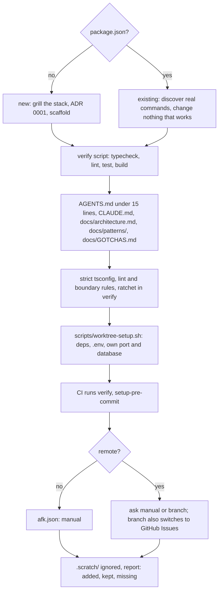

# setup-project

Get a new or existing TypeScript and React repo ready for unattended agent work.

## What It Does



## Usage

```text
/setup-project
/setup-project in this empty folder, it's a booking app for a small clinic
/setup-project on this repo, it already has CI
```

## Output

- `AGENTS.md`, `CLAUDE.md` (`@AGENTS.md`), `verify` and `ratchet` scripts in `package.json`
- Strict tsconfig flags, lint rules (oxlint or ESLint, whichever the repo uses), `knip.json`, `scripts/ratchet.mjs`, `.ratchet.json`; an axe-core scan for UI repos (the e2e runner's integration, or `scripts/a11y-scan.sh`); `stryker.config.mjs` only on request
- `scripts/worktree-setup.sh`, `docs/architecture.md`, `docs/patterns/`, `docs/GOTCHAS.md`, `docs/adr/0001-stack.md` (new only)
- `.github/workflows/verify.yml`, `.husky/pre-commit`, `.claude/afk.json`, `.scratch/` in `.gitignore`

## Requirements

- Sibling skills it calls by name: `setup-pre-commit` (always) and `setup-matt-pocock-skills` (only with `"push": "branch"`; its SKILL.md is read and followed, since it is not model-invocable).
- `git` and `node`; `gh` is not needed. `scripts/a11y-scan.sh` also needs the agent-browser CLI.

## FAQ

- Does it commit? No. It ends with a report of what it added, kept or found missing.
- What does the ratchet do? It fails `verify` when unused code, duplication or complexity warnings grow, and lowers `.ratchet.json` when they shrink.
- Why worktree-setup.sh? Parallel agents each get a worktree; without their own port and database they collide.
