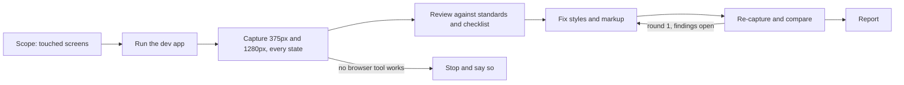

# UI Polish

Looks at the rendered UI after a change and fixes what looks unfinished.

## What It Does



## Usage

```text
The quiz page works but looks unfinished, polish it
Check the look of this branch on mobile before I review
Tidy up the spacing on the settings form I just added
Polish the UI changes since main
```

## Output

- Style and markup changes in the working tree, never behaviour or tests.
- Before and after screenshots under `.scratch/<feature>/ui-polish/` when that folder exists.
- A report: what was fixed, what needs a human eye, what could not be captured.

## Requirements

- A way to take screenshots: a browser extension such as Claude in Chrome, a Playwright MCP server, or Node with Playwright for the CLI fallback.
- The project's dev command, so the app can run locally.

## FAQ

- When do I run it? After a UI change is implemented and before code review.
- Does it change behaviour? No. Fixes that need behaviour or copy changes go in the report.
- How long does it go? Two fix rounds at most, then it reports.
- What if no browser tool works? It stops and says what it tried; it never reviews code in place of screenshots.
