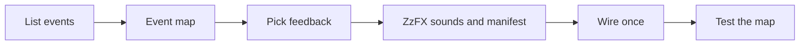

# Game Feel

Gives every gameplay event a sound and a visible reaction, and checks the list with a test.

## What It Does



## Usage

```text
The game works but feels flat, add juice
Add sound effects to every event in the game
Add screen shake and hit-stop when the player gets hit
The playtest says an event has no sound wired, fix it
```

## Output

- An audio event map in the game's treatment document and in code.
- A sounds module of ZzFX parameters, manifest entries with licenses, and a test and playtest check for unwired events.

## FAQ

- Where do sound effects come from? ZzFX, generated from parameter arrays; music and recordings may come from any source, with the license recorded.
- Can an event have no sound? Only as a recorded decision in the map.
