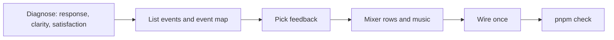

# Game Feel

Gives every gameplay event a sound and a visible reaction, and checks the list with a test.

## What It Does



## Usage

```text
The game works but feels flat, add juice
Add sound effects to every event in the game
Add screen shake and hit-stop when the player gets hit
The playtest says an event has no sound wired, fix it
```

## Output

- An event map in code and a `sounds.ts` of mixer rows, recipes and a music pattern; `pnpm check` verifies them.

## FAQ

- Where do sounds come from? Synth recipes in `@lab/audio`, no sample files.
- Where do I start? Diagnose first: response, then clarity, then satisfaction.
- Can an event have no sound? Only as a recorded decision in the map.
