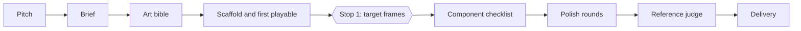

# Conduct

Starts the conductor on an approved pitch and walks away; it stops only when your judgement is needed.

## What It Does



| Phase | Output |
| ----- | ------ |
| Brief, art bible | `GDD.md` or `TREATMENT.md`, `ART-BIBLE.md` (signed on your behalf, logged) |
| Target frames | stop 1: you approve a target |
| Checklist | `COMPONENTS.md`: target, folder and lens per component |
| Polish, judge, delivery | review packet, `DECISIONS.md`, `RUN.md` |

## Usage

```text
/conduct apps/games/tide-runner/PITCH.md
/conduct apps/games/tide-runner
/conduct apps/pieces/fog/PITCH.md rounds=3 hours=2, also stop before delivery
```

## Output

`RUN.md` in the app folder, append-only and committed. To answer a stop, append `- <UTC timestamp> | answer | <your answer>` and run `/conduct <app>` again.

## Requirements

- The lab repo with `pnpm verify` and `pnpm asset target`.
- Stops are announced with a push notification; without the tool, the line is in `RUN.md`.

## FAQ

- Default stops? Target frames, polish plateau, split taste call, a gate failing twice, a spent budget.
- Default budget? 6 polish rounds and 4 hours, overridable in the request or the brief.
