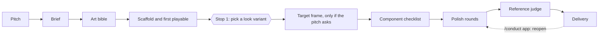

# Conduct

Starts the conductor on an approved pitch and walks away; it stops only when your judgement is needed.

## What It Does



| Phase | Output |
| ----- | ------ |
| Brief, art bible | `GDD.md` or `TREATMENT.md`, `ART-BIBLE.md` (signed on your behalf, logged) |
| Look variants | stop 1: three looks from the first playable, you answer with one line naming one (`look=auto` picks for you and logs it); a target frame stop follows only when the pitch asks for a target |
| Checklist | `COMPONENTS.md`: target, folder and lens per component |
| Polish, judge, delivery | review packet, `DECISIONS.md`, `RUN.md` |

## Usage

```text
/conduct apps/games/tide-runner/PITCH.md
/conduct apps/games/tide-runner
/conduct apps/experiments/fog/PITCH.md rounds=3 hours=2, also stop before delivery
/conduct apps/experiments/fog/PITCH.md process=minimal
/conduct apps/games/tide-runner/PITCH.md look=auto
/conduct work on this game overnight for 6h
/conduct work on this game and call me each round
/conduct apps/games/tide-runner rounds=3, focus on the waterfalls
```

## Output

`RUN.md` in the app folder, append-only and committed. To answer a stop, append `- <UTC timestamp> | answer | <your answer>` and run `/conduct <app>` again. One conductor runs per app: it holds `RUN.md.lock` (owner and start time, uncommitted) and a second start is refused while the lock is held; a lock not refreshed for 2 hours counts as stale.

## Requirements

- The lab repo with `pnpm verify` and `pnpm asset target`.
- Subagents nest three levels (conductor, director, worker or judge); no extra launch or permission mode is needed.
- `/conduct` sends a push notification from the main thread at every stop and at delivery; the conductor also sends one with play links after the first finished slice (a `wip` line) and keeps going. An `answer` line written while no stop is pending is read at the next round as notes. Without the tool, the line is in `RUN.md`.

## FAQ

- Overnight or review? "Overnight for 6h", "while I sleep", "on its own" and "autonomously" run autonomously until the hours are spent and every row, trailer and sound included, is at target (no accept cap, judge splits settled by the lower score); "call me each round", a bare duration ("work on this for 6h", which only sets `hours=6`) or no mode stops after every round with the packet. `mode=overnight|review`.
- Trailer and evolution? Before delivery the conductor directs and judges the app's trailer (`pnpm verify <app> --trailer`), inside the delivery reserve; every round, reverted tries included, is recorded with `--round`, and the hand-off links `evolution.html`.
- Default stops? Look variant (none with `look=auto`), target frames (only when the pitch asks for a target), polish plateau, split taste call, a gate failing twice, a spent budget.
- More polish after delivery? Run `/conduct <app>` on the delivered app, no new pitch: it reopens the run in polish with a fresh budget leg, seeded from the open items in `DECISIONS.md` and the judges' notes.
- Games and experiments? One flow for both. `run_state.py step` decides each next action and `profile` says what the app's kind changes: an experiment (an audio visualizer, a particle field) writes a treatment, gets no game rows, gets `motion` and `input` rows, and judges motion every round.
- Default budget? 6 polish rounds (fewer with `process=minimal`) and 6 hours of active run time per run, summed across stops and resumes, overridable in the request or the brief.
