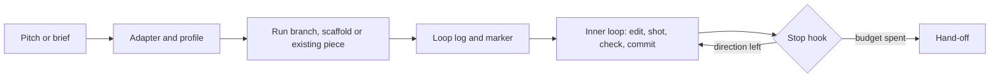

# Creative Loop

Runs one game, experiment or site piece from a pitch or brief to a checked, recorded build, in your own session, in the lab or any repo set up for it.

## What It Does



| Phase | Output |
| ----- | ------ |
| Adapter | the repo's shot, check, verify and record commands (the lab's by default) and a profile: game, experiment or site |
| Branch | `loop/<app>` in its own worktree, or the current branch when the piece already exists |
| Log | `LOOP.md` header, directions from the brief, GitHub issues or `.scratch/` tickets, `.loop-active` |
| Cycles | one commit and one log line per green cycle, an on-track verdict per direction |
| Hand-off | a summary, met tickets closed, files sent to you, a push notification; `verify` and `record` with `--slow-checks`, a run article (one frame per cycle, time and cost, as a private artifact page) with `--article` |

## Usage

```text
/creative-loop a one-button arcade game about a lighthouse keeper --budget 45m
/creative-loop apps/fog/BRIEF.md --mode overnight --budget 8h
/creative-loop a game about tides --budget 20cycles
/creative-loop a game about tides --attempts 3 --mode overnight --budget 8h
/creative-loop docs/world/BRIEF.md --mode overnight --budget 8h
/creative-loop docs/world/BRIEF.md --budget 8h --slow-checks --article
```

## Output

The run branch with the piece and `LOOP.md`, and the adapter's `out` folder (lab: `.verify/<app>/` with record, check, packet and summary).

## Requirements

The lab monorepo, or a repo set up with `/setup-creative-loop`; the Stop hook installed by `./install.sh`; `jq`; `gh` for a GitHub directions source; and the `ideation`, `brief`, `three-build`, `game-feel`, `game-design` and `ui-polish` skills.

## FAQ

- Does overnight merge or push? Never; it also never deploys, deletes branches or spends money.
- What if nobody answers? Defaults are taken and logged under Notes.
- Where do I steer a running loop? Add a line under `## Notes` in `LOOP.md`.
- Does it work outside the lab? Yes, after `/setup-creative-loop` writes `.claude/creative-loop.json` for the repo.
- Do game rules apply to a site? No, only the game profile loads them.
- Does it touch tickets? It sets met `.scratch/` tickets to `done` and closes met GitHub issues at hand-off, with a comment; nothing else.
- Does it run several attempts? In the lab, with `--attempts 2` or `3`: one worktree and subagent per attempt, a stacked video, and you pick.
