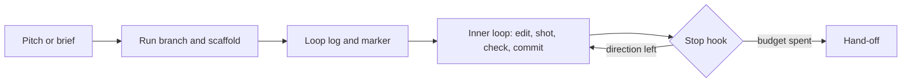

# Loop

Runs one game or experiment from a pitch or brief to a checked, recorded build, in your own session.

## What It Does



| Phase | Output |
| ----- | ------ |
| Branch | `loop/<app>` in its own lab worktree |
| Log | `LOOP.md` header, directions from the brief, `.loop-active` |
| Cycles | one commit and one log line per green cycle, an on-track verdict per direction |
| Hand-off | `pnpm verify`, `pnpm record`, a summary, files sent to you, a push notification |

## Usage

```text
/loop a one-button arcade game about a lighthouse keeper --budget 45m
/loop apps/fog/BRIEF.md --mode overnight --budget 8h
/loop a game about tides --budget 20cycles
```

## Output

The run branch with the app, `LOOP.md`, `.verify/<app>/` (record, check, packet, summary).

## Requirements

The lab monorepo, the Stop hook installed, and the `ideation`, `brief`, `three-build` and `game-feel` skills.

## FAQ

- Does overnight merge or push? Never; it also never deploys, deletes branches or spends money.
- What if nobody answers? Defaults are taken and logged under Notes.
- Where do I steer a running loop? Add a line under `## Notes` in `LOOP.md`.
- Does it run several attempts? No, one; attempts mode is separate.
