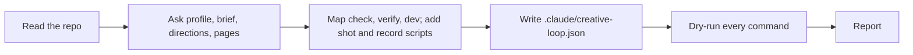

# Setup Creative Loop

Prepares a repo once so `/creative-loop` can run in it.

## What It Does



## Usage

```text
/setup-creative-loop
Set this repo up for the creative loop
```

## Output

- `.claude/creative-loop.json`, the adapter the loop reads.
- `scripts/creative-loop/shot.mjs` and `record.mjs` when the repo has no screenshot or record tool of its own.
- The adapter's output folder added to `.gitignore`. Nothing is committed.

## Requirements

`jq`; `playwright` in the repo for the bundled scripts; `ffmpeg` and ImageMagick `montage` for an mp4 and a contact sheet (without them: webm and a frames folder).

## FAQ

- Does the lab need it? No, the loop has the lab's commands built in.
- Can I run it again? Yes, it shows the current adapter and changes only what you ask.
