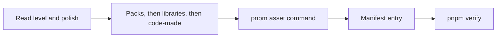

# Asset Pipeline

Sources game assets from packs and libraries, or makes them in code, and records each one with its license.

## What It Does

| Level | Allowed |
| ----- | ------- |
| `placeholder` | Primitives and grey boxes; no script runs |
| `free` | Kenney and Quaternius packs, Poly Haven, ambientCG, gltf-transform |
| code-only mode | No asset files; everything is made by code |
| `premium` | Refused while locked |

| Polish | Steps |
| ------ | ----- |
| `rough` | Fetch, clean up, record |
| `polished` | Style test sheet, optimization, record, user approval |



## Usage

```text
Get me a rock wall texture for the arena floor
Find a crate model that fits the pirate theme
Can we use this model in a commercial release?
verify says the asset manifest fails, fix it
```

## Output

- `assets.manifest.json` and `public/assets/` in the app; style test sheets in `art/style-test/`.

## Requirements

- The lab monorepo. Pack contact sheets need ffmpeg; models need gltf-transform. Poly Haven and ambientCG need network.

## FAQ

- Can it use paid providers? No, `premium` is locked.
- Can I drop a file in by hand? No; without a manifest entry `verify` fails it.
