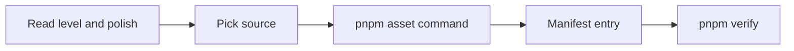

# Asset Pipeline

Sources and generates game assets through the lab's scripts and records each one with its license.

## What It Does

| Level | Allowed |
| ----- | ------- |
| `placeholder` | Primitives and grey boxes; no script runs |
| `free` | Poly Haven and ambientCG, local mflux generation, rembg, gltf-transform |
| `premium` | Refused while locked |

| Polish | Steps |
| ------ | ----- |
| `rough` | Generate or fetch, clean up, record |
| `polished` | Style test sheet, more generation steps, optimization, record, user approval |



## Usage

```text
Get me a rock wall texture for the arena floor
Generate a wooden crate sprite and cut out the background
Can we use this model in a commercial release?
verify says the asset manifest fails, fix it
```

## Output

- `assets.manifest.json` and `public/assets/` in the app; style test sheets in `art/style-test/`.

## Requirements

- The lab monorepo. Local generation needs mflux; cutouts need rembg; models need gltf-transform. Poly Haven and ambientCG need network.

## FAQ

- Can it use paid providers? No, `premium` is locked.
- Can I drop a file in by hand? No; without a manifest entry `verify` fails it.
