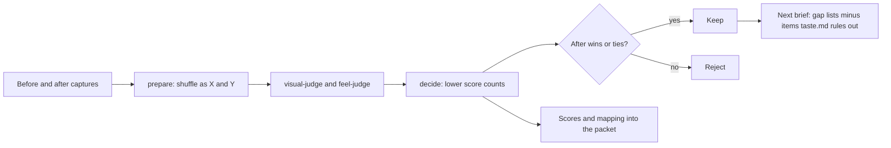

# Realtime Judge

Blind before/after judging for polish rounds, with two lenses and the lower score counting.

## What It Does



## Usage

```text
Judge this polish round blind
Did the new lighting actually improve the arena? Score before and after
Put the judge scores in the review packet
Can a judge tell my render from the reference? Run the 12-trial test
```

## Output

- A judge directory per moment with `x.png` and `y.png` only.
- A mapping file per moment (kept out of the judges' reach) and a markdown block for the packet with both scores, the counted score and the decision.
- The next round's brief, with every dropped gap item and the taste line that ruled it out.

## Requirements

- Python 3, and before and after PNG captures taken at the same moments.
- The `visual-judge` and `feel-judge` agents.

## FAQ

- Does a reject block a merge? No, judges advise; `verify` gates are the hard checks.
- Why the lower score? One judge spotting a flaw should be enough to doubt the change.
- Can it tell a render from its reference? Yes: `discriminate-prepare` builds 12 shuffled trials and `discriminate-score` counts the real picks; 7 or fewer of 12 passes.
- Can it judge motion? Yes: `decide --motion` takes a motion judge's X and Y scores, and `prepare` shuffles two folders of motion sheets.
