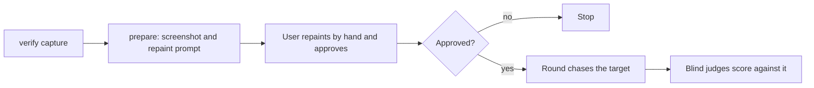

# Target Loop

Repaint a real screenshot into a target frame the user approves, then chase it round by round.

## What It Does



## Usage

```text
Make a target frame for the ripple toy
Write the repaint prompt for this scene and get it ready for me to run in Gemini
Run a polish round against the approved target
```

## Output

- `<app>/targets/<id>.source.png`, `<id>.prompt.txt` and, after the user submits it, `<id>.png`.
- A manifest entry for the target image, `pending` until the user approves it.

## Requirements

- The lab repo's `verify` and `pnpm asset target ...` commands.
- An image app the user runs by hand (the Gemini app, no API).

## FAQ

- Can the agent approve a target? No; approval needs the user at a terminal typing yes.
- Is the target shipped? No, it lives under `targets/`, outside `public/`.
