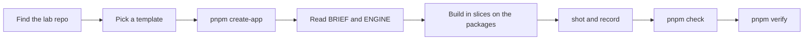

# Three Build

Builds games and creative experiments in the lab monorepo on three.js WebGPURenderer.

## What It Does



## Usage

```text
Add a new example app to the lab with a water ripple effect
Start a new game in the lab from the game template
Check the game and fix what fails before we call it done
```

## Requirements

- A checkout of the lab monorepo with pnpm and the Node version the lab's `package.json` requires.
