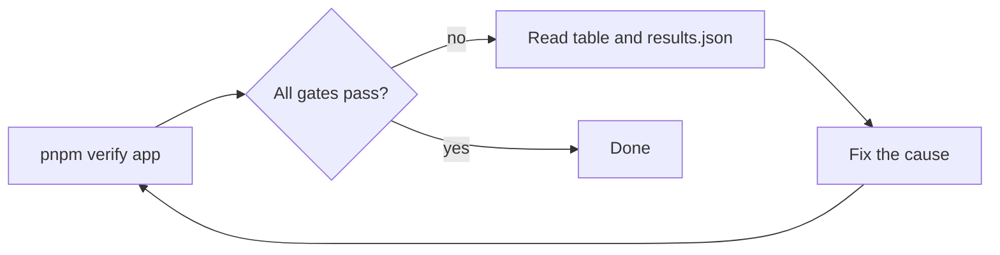

# Three Verify

Runs the lab's `verify` gates for an app and fixes whatever fails.

## What It Does



## Usage

```text
Verify the ripple-toy experiment
The mobile fps gate fails on my game, fix it
Is this app ready to hand over?
```

## Output

- `.verify/<app>/results.json` in the lab repo, written by `verify`.

## Requirements

- The lab monorepo, a GPU-capable machine and Playwright Chromium.

## FAQ

- Can it loosen a threshold? No, that needs the user's approval.
